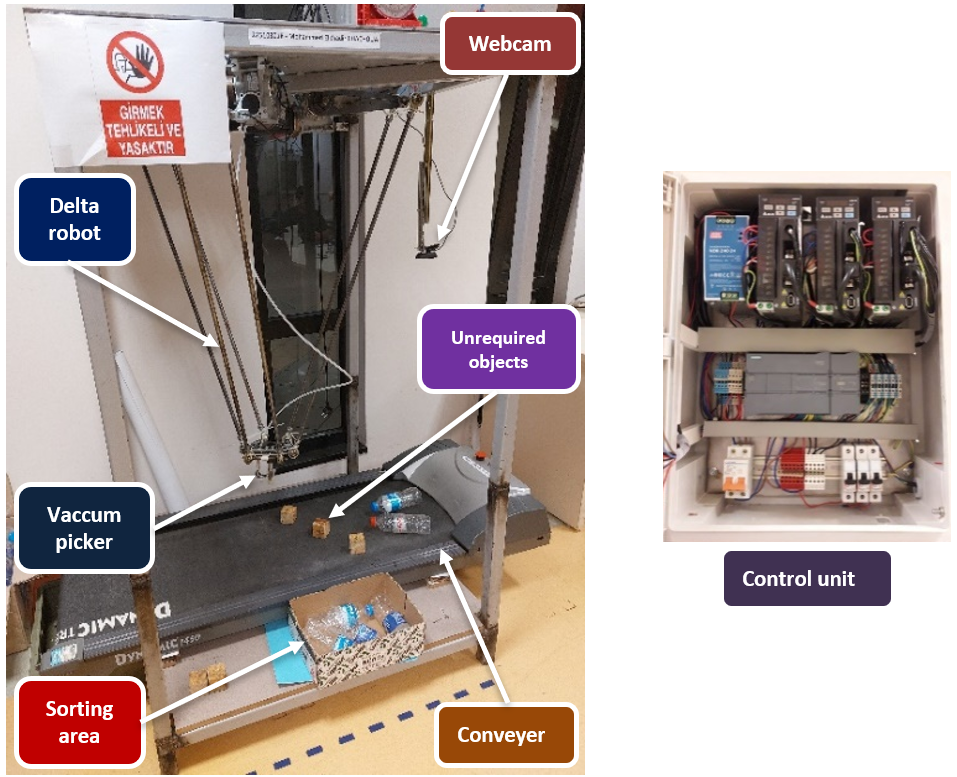
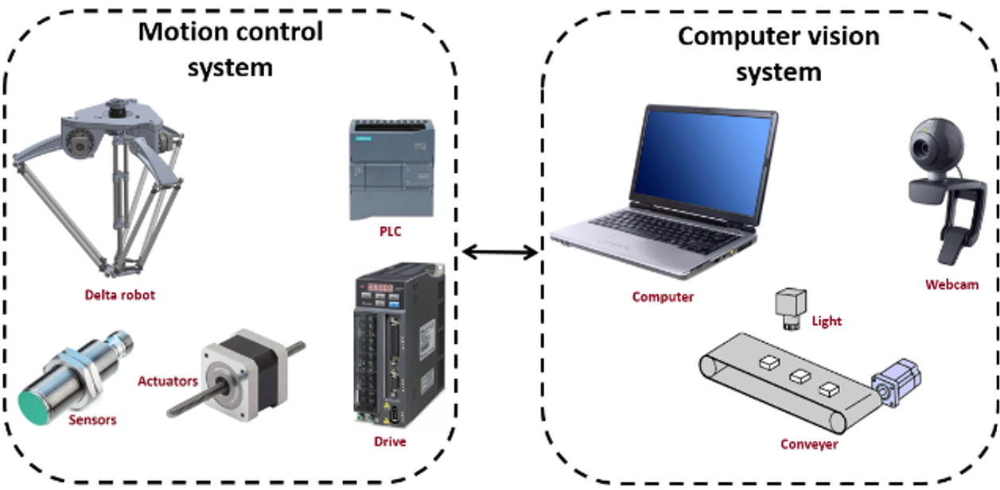
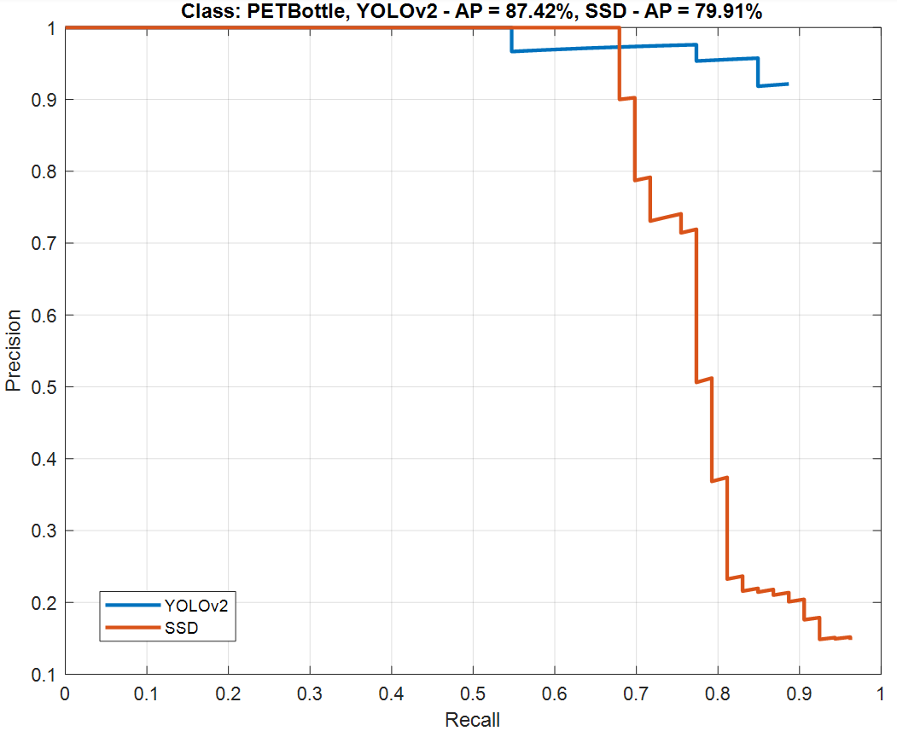
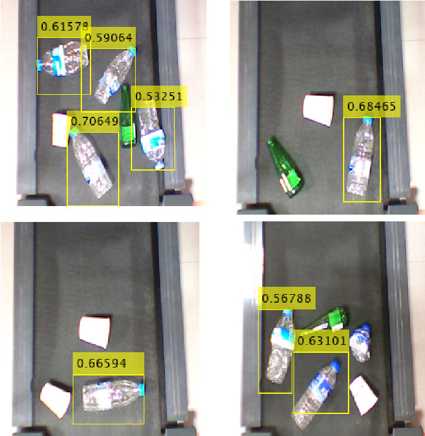
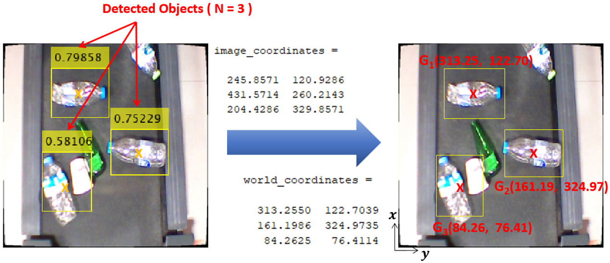
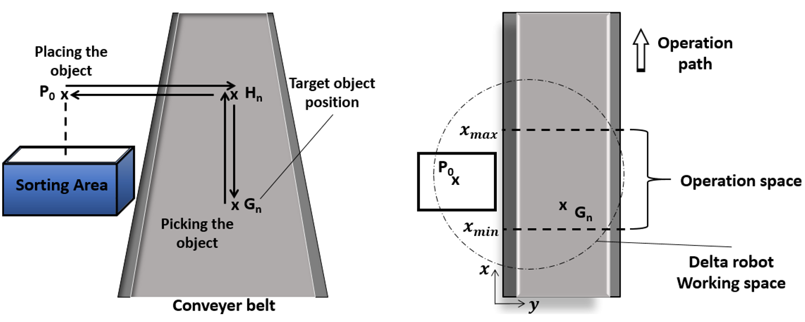
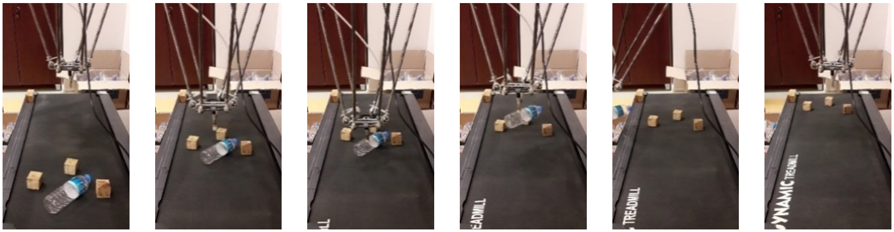

# Delta Robot Sorting System Controlled with PLC Based on Object Detection

Master's thesis | Electronics & Communication Engineering, Kocaeli University | December 2024

**Author:** Mohammed Elkhadir Chachoua
**Supervisor:** Assoc. Prof. Dr. Sıtkı Öztürk

A vision-guided pick-and-place system. A webcam and a deep-learning detector find PET bottles on a moving conveyor, camera calibration converts their image positions into real-world coordinates, and a PLC-controlled delta robot picks each bottle with a vacuum gripper and drops it in a sorting area.

> **Note:** the source code (MATLAB programs and the PLC project) is not archived. This repository documents the project through the full thesis, which contains the method, equations, algorithm and results. The thesis is written in Turkish, and an English version is included.



## Highlights

- **Kinematics:** forward and inverse kinematics of the delta parallel robot were derived and validated in MATLAB on a 300 mm circular reference path, with position errors around 10⁻¹³ mm. The robot's 3D workspace was computed from the model.
- **PLC and servo control:** three servo axes run from a Siemens S7-1215C PLC (TIA Portal, ladder logic) using pulse-train outputs and motion-control blocks.
- **Camera calibration:** 8 checkerboard images (25 mm squares), mean reprojection error **0.11 pixels**. The calibration converts pixel positions into robot-frame coordinates.
- **Detection:** YOLOv2 and SSD (ResNet-50 backbone, pre-trained on COCO) were fine-tuned on a 91-image PET bottle dataset for 30 epochs. Average precision (AP): **YOLOv2 87.42%**, SSD 79.91%.
- **Moving targets:** a position-update method tracks each bottle while it travels on the belt.
- **Integration:** MATLAB vision and the PLC exchange data through OPC. The full system sorted PET bottles from a moving conveyor, leaving the other objects (wooden cubes) in place.

## How it works

1. Home the robot and calibrate the camera (checkerboard images, MATLAB).
2. Capture an image and detect PET bottles with the trained YOLOv2 model.
3. Convert each detection from image to world coordinates.
4. Update each target's position for the conveyor motion: the belt moves along x with speed v, so `x(i+1) = x(i) + v · t(i)` and y stays constant.
5. Plan the pick-up path and compute joint angles and velocities with the inverse kinematics.
6. Send the targets to the PLC through OPC (the vision system is the OPC client, the robot control system is the OPC server).
7. The PLC moves the three servo motors (PTO outputs; `MC_POWER`, `MC_HOME`, `MC_MOVEABSOLUTE`). The robot picks the bottle and places it in the sorting area.



### Algorithm (from the thesis)

```
Start; home the robot; calibrate the camera
while not finished:
    capture image; process image; detect objects; compute visual positions
    K = number of target points
    if K == 0: continue
    for i = 1..K:
        plan waypoints; predict position; compute joint angles; get target data
        motion_control()

function motion_control():
    read the next target's data
    if the target is outside the workspace: skip it
    compute velocities and robot position
    write them to the PLC data block
```

## Results

Precision-recall curves of the two detectors (YOLOv2 and SSD):



YOLOv2 detections on test images:



Visual positioning: detected objects and their world coordinates:



The pick-and-place path planned for each object:



The sorting sequence: detect, approach, pick, drop in the sorting area:



## Hardware and software

| Part | Details |
|------|---------|
| Robot | 3-DOF delta parallel robot, three AC servo motors and drivers, vacuum suction gripper |
| PLC | Siemens S7-1215C, programmed in TIA Portal (ladder logic) |
| Camera | Logitech C310 HD webcam (1280 × 720), mounted 700 mm above the conveyor, 60° diagonal field of view |
| Conveyor | Belt conveyor carrying PET bottles and other objects |
| Software | MATLAB (image processing, deep learning, calibration, kinematics, OPC), TIA Portal, OPC server |

## Thesis contents

Literature review, background (image processing, camera calibration, deep-learning object detection), robotics mathematics (position, orientation, homogeneous transforms, forward and inverse kinematics), the delta robot kinematic model and its numerical validation, system design, servo position control with a PLC, camera calibration, and the implementation of the sorting system. Full text: [English version](docs/thesis_english.pdf) | [Turkish original](docs/thesis.pdf).

## Limitations and future work

- All experiments were done in a controlled lab with fixed conditions. Changing light, dirt or irregular objects would need more work.
- Some mechanical errors came from the robot design, and a calibration offset sometimes made the robot grab in front of or behind the object's center.
- Encoder-based position estimation was slightly more accurate than vision-based estimation, but vision stayed within the accuracy needed for pick-and-place.
- Planned improvements from the thesis: a higher-resolution camera, a more sophisticated calibration method, and optical-flow speed estimation compared with the frame-difference method used here.

## Publication

Chachoua, M. E., & Öztürk, S. (2024). *Derin Öğrenme İle PLC Kontrollü Delta Robot Pet Şişe Ayrıştırma Sistemi Uygulaması*. In F. Kuncan & A. Yıldırım (Eds.), *Disiplinlerarası Akademik Çalışmalar* (2nd ed., pp. 61-93). İKSAD, Ankara. [Book chapterl](docs/DISIPLINLERARASI-AKADEMIK-CALISMALAR-II.pdf) DOI: [10.5281/zenodo.13825221](https://doi.org/10.5281/zenodo.13825221) | [Publisher page](https://iksadyayinevi.com/book/613)

## Files

- `docs/thesis_english.pdf`: full thesis (English version)
- `docs/thesis.pdf`: full thesis (Turkish original)
- `docs/DISIPLINLERARASI-AKADEMIK-CALISMALAR-II.pdf`: Published Book Chapter (Turkish original)
- `images/`: figures from the thesis

## Credits

- Delta robot kinematics MATLAB code by Y. Smirnova (2023, MATLAB Central File Exchange), used to support the workspace analysis
- Zhang, Z. (2000). A Flexible New Technique for Camera Calibration, and Bouguet's Camera Calibration Toolbox for MATLAB
- MATLAB, TIA Portal and OPC server software are third-party products and are not included here
